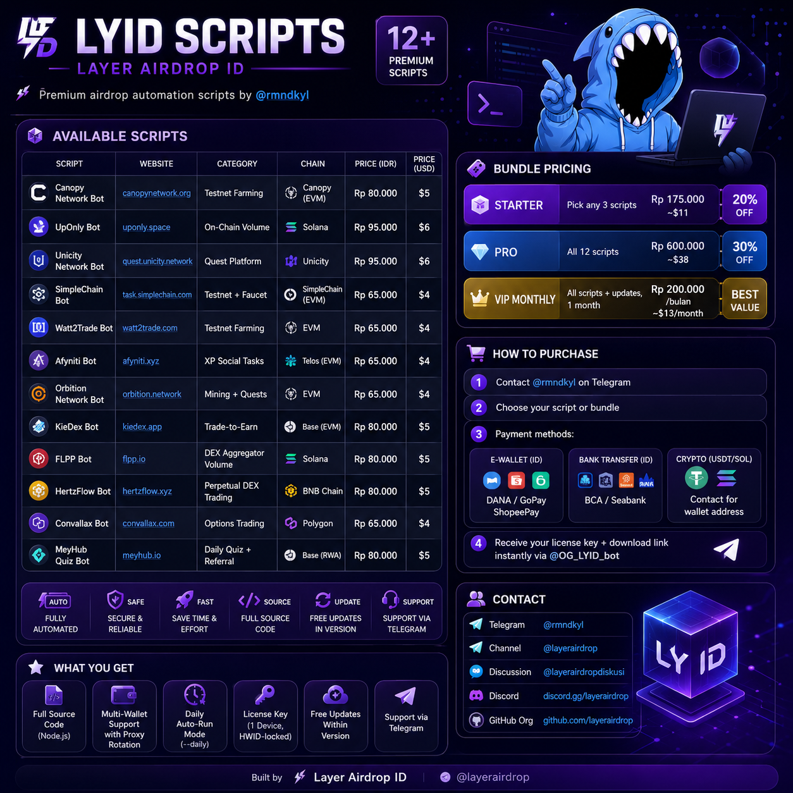

  

# LYID Scripts — Layer Airdrop ID

> Premium airdrop automation scripts by **@rmndkyl**

## Available Scripts

| Script | Website | Category | Chain | Price (IDR) | Price (USD) |
|--------|---------|----------|-------|-------------|-------------|
| [Canopy Network Bot](https://github.com/rmndkyl/canopy-bot) | [canopynetwork.org](https://rewards.testnet.app.canopynetwork.org) | Testnet Farming | Canopy (EVM) | Rp 120.000 | $8 |
| [UpOnly Bot](https://github.com/rmndkyl/uponly-bot) | [uponly.space](https://uponly.space) | On-Chain Volume | Solana | Rp 150.000 | $10 |
| [Unicity Network Bot](https://github.com/rmndkyl/unicity-bot) | [quest.unicity.network](https://quest.unicity.network) | Quest Platform | Unicity | Rp 150.000 | $10 |
| [SimpleChain Bot](https://github.com/rmndkyl/simplechain-bot) | [task.simplechain.com](https://task.simplechain.com) | Testnet + Faucet | SimpleChain (EVM) | Rp 100.000 | $6 |
| [Watt2Trade Bot](https://github.com/rmndkyl/watt2trade-bot) | [watt2trade.com](https://www.watt2trade.com/) | Testnet Farming | EVM | Rp 100.000 | $6 |
| [Afyniti Bot](https://github.com/rmndkyl/afyniti-bot) | [afyniti.xyz](https://afyniti.xyz) | XP Social Tasks | Telos (EVM) | Rp 100.000 | $6 |
| [Orbition Network Bot](https://github.com/rmndkyl/orbition-bot) | [orbition.network](https://airdrop.orbition.network) | Mining + Quests | EVM | Rp 100.000 | $6 |
| [KieDex Bot](https://github.com/rmndkyl/kiedex-bot) | [kiedex.app](https://kiedex.app) | Trade-to-Earn | Base (EVM) | Rp 120.000 | $8 |
| [FLPP Bot](https://github.com/rmndkyl/flpp-bot) | [flpp.io](https://flpp.io) | DEX Aggregator Volume | Solana | Rp 120.000 | $8 |
| [HertzFlow Bot](https://github.com/rmndkyl/hertzflow-bot) | [hertzflow.xyz](https://testnet.hertzflow.xyz) | Perpetual DEX Trading | BNB Chain | Rp 120.000 | $8 |
| [Convallax Bot](https://github.com/rmndkyl/convallax-bot) | [convallax.com](https://www.convallax.com/predict) | Options Trading | Polygon | Rp 100.000 | $6 |
| [MeyHub Quiz Bot](https://github.com/rmndkyl/meyhub-bot) | [meyhub.io](https://meyhub.io) | Daily Quiz + Referral | Base (RWA) | Rp 120.000 | $8 |
| [PeakAI Bot](https://github.com/rmndkyl/peakai-bot) | [takeapeak.ai](https://www.takeapeak.ai/genesis) | Daily Check-in + Referral | EVM | Rp 120.000 | $8 |
| [Inception Bot](https://github.com/rmndkyl/inception-bot) | [inception.dachain.io](https://inception.dachain.io) | Testnet + Badges + Faucet | DAC Chain | Rp 120.000 | $8 |
| [Chesto Bot](https://github.com/rmndkyl/chesto-bot) | [chesto.ai](https://chesto.ai) | KARMA + USDC Social Tasks | Base | Rp 120.000 | $8 |
| [AlloX Bot](https://github.com/rmndkyl/allox-bot) | [allox.ai](https://app.allox.ai) | XP Social + Portfolio | Multi-chain | Rp 80.000 | $5 |
| [Luxa Bot](https://github.com/rmndkyl/luxa-bot) | [luxaecosystem.xyz](https://luxaecosystem.xyz) | TG Mining (Type E) | Cosmos L1 | Rp 65.000 | $4 |
| [Bull Games Bot](https://github.com/rmndkyl/bullgems-bot) | [gem.bullshot.io](https://gem.bullshot.io) | Mining **semua tier lokasi** (Crystal Cavern / Ember / Frozen / Void Rift) + strategy best/fastest/spread + Quests + Auto Upgrade / Equipment / Achievements + **XP Farm (P2P 75 XP/buy, Swap 5 XP lossless)** + Token Cache & Humanisasi | Base (EVM) | Rp 95.000 | $6 |
| [Tzero Bot](https://github.com/rmndkyl/tzero-bot) | [testnet.tzer0.fun](https://testnet.tzer0.fun) | Testnet Launchpad + point engine (Crew sniper Multicall3 2.000 misi, Fuel ladder, group-buy state machine, poin resmi dari API proyek, 24 script operator) | Base Sepolia | Rp 120.000 | $8 |
| [nGRND Gold Protocol Bot](https://github.com/rmndkyl/ngrnd-bot) | [digitsbt.ngrndrewards.com](https://digitsbt.ngrndrewards.com/sbt/tasks) | Daily Streak + Quest Auto-Verify (2 campaign) | Off-chain (RWA Gold) | Rp 95.000 | $6 |
| [9Chain Community Bot](https://github.com/rmndkyl/9chain-bot) | [9chain.com](https://www.9chain.com) | Simulated Node Farming (TOTP auth, auto taps 1000/day, daily gift, ROI upgrade) | 9Chain L1 (off-chain points) | Rp 65.000 | $4 |
| [My Age Bot](https://github.com/rmndkyl/myage-bot) | [myageapp.xyz](https://myageapp.xyz) | Telegram Mini App Farming (initData otomatis via MTProto, tasks, daily, spin, mystery, vault) | TON ($AGE / $GRAM) | Rp 95.000 | $6 |
| [TastyCo Bot](https://github.com/rmndkyl/tastyco-bot) | [app.tastyco.io](https://app.tastyco.io) | Daily Rewards Ladder (500 → 50.000 UP) + Weekly Quiz auto (jawaban dari metadata) + Quest Claim (COMPLETED **dan** AVAILABLE-with-satisfied-progress), humanisasi slot per wallet | BNB Chain ($TASTY) | Rp 95.000 | $6 |
| [Elyon Bot](https://github.com/rmndkyl/elyon-bot) | [airdrop.elyon.network](https://airdrop.elyon.network) | Testnet Quest (18 task: faucet harian, transfer, mint badge, delegate) + login SIWE + auto-solve anti-bot PoW & captcha SVG + humanisasi per wallet | Elyon (EVM testnet) | Rp 80.000 | $5 |
| [Lucia Bot](https://github.com/rmndkyl/lucia-bot) | [airdrop.luciaprotocol.com](https://airdrop.luciaprotocol.com) | Airdrop Points Quest | EVM | Rp 65.000 | $4 |
| [Polyester Bot](https://github.com/rmndkyl/polyester-bot) | [testnet.polyester.com](https://testnet.polyester.com) | Daily Paper Assets Claim (Ed25519 signed REST, 0 dependency) + optional paper order activity, humanisasi per akun | Polyester Chain (testnet) | Rp 80.000 | $5 |
| [ZXOXO Bot](https://github.com/rmndkyl/zxoxo-bot) | [zxoxo.xyz](https://zxoxo.xyz) | Off-chain mining farmer: claim ZXO, beli rig (ladder 800-24.000), overclock, jump untuk misi + pantau access signal. Cookie auth, tanpa private key, humanisasi persona per wallet | ZXOXO (LayerZero testnet theme) | Rp 65.000 | $4 |

## Bundle Pricing

| Bundle | Description | Price (IDR) | Price (USD) | Savings |
|--------|-------------|-------------|-------------|---------|
| **Starter** | Pick any 3 scripts | from Rp 168.000 (20% off the three) | ~$11 | 20% off |
| **Pro** | All 27 scripts | Rp 1.932.000 | ~$129 | 30% off |
| **VIP Monthly** | All scripts + updates, 1 month | Rp 300.000/bulan | ~$19/month | Best value |

## How to Purchase

1. Contact **@rmndkyl** on Telegram
2. Choose your script or bundle
3. Payment methods:
   - **E-Wallet (ID):** DANA / GoPay / ShopeePay
   - **Bank Transfer (ID):** BCA / Seabank
   - **Crypto (USDT/SOL):** Contact for wallet address
4. Receive your license key + download link instantly via **@OG_LYID_bot**

## What You Get

- Full source code (Node.js)
- Multi-wallet support with proxy rotation
- Daily auto-run mode (`--daily`)
- License key (1 device, HWID-locked)
- Free updates within version
- Support via Telegram

## Contact

| | |
|---|---|
| **Telegram** | [@rmndkyl](https://t.me/rmndkyl) |
| **Channel** | [@layerairdrop](https://t.me/layerairdrop) |
| **Discussion** | [@layerairdropdiskusi](https://t.me/layerairdropdiskusi) |
| **Discord** | [discord.gg/layerairdrop](https://discord.gg/layerairdrop) |
| **GitHub Org** | [github.com/layerairdrop](https://github.com/layerairdrop) |

---

*Built by [Layer Airdrop ID](https://t.me/layerairdrop)*
